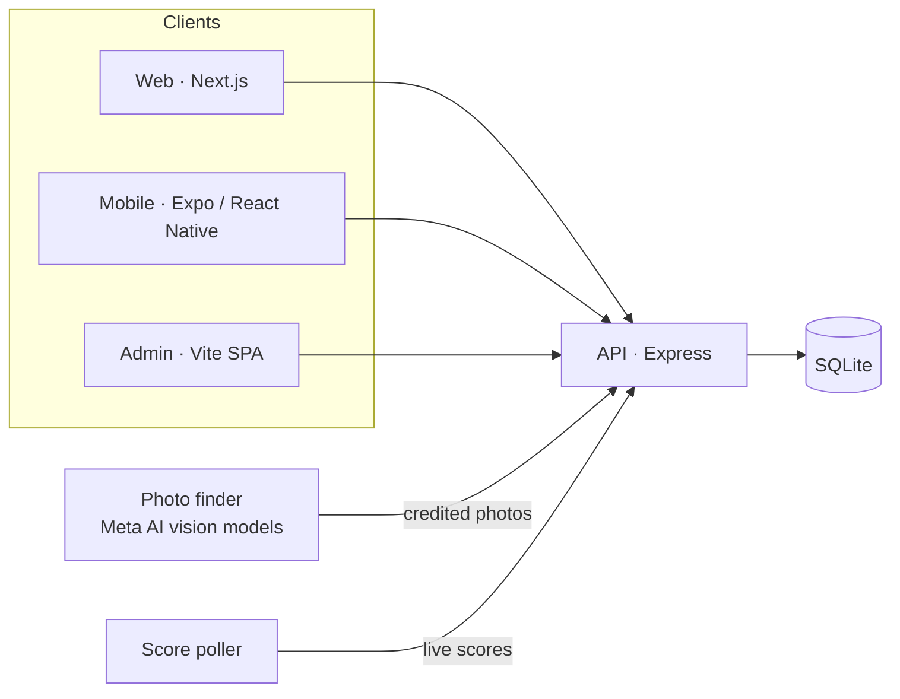

# Joinaroo

**Walk the room of your city's night — without leaving the couch.**

[](https://joinaroo.com)


Joinaroo is a local events platform for Maine — piloting in **Portland** and **Orono** — that answers a question no listing site can: *is anyone actually there?*

Every aggregator can tell you a show exists. Joinaroo shows you the room.

---

## The idea: the people layer

Event data is a commodity — every aggregator has the same feeds. Joinaroo's layer is **people**:

- After an event starts, an automated **photo finder** scans public Instagram and Facebook posts from the show — fans, artists, venues, and professional photographers — and attaches them to the listing, fully credited (name, studio, links, avatar).
- A listing with real people in it becomes a **live event card**: an avatar stack, a headcount ("3 people here now"), and a pulsing LIVE badge, promoted to the top of Featured while the event is happening.
- On an event page, the people at the show are listed in a **Live now!** panel. You can open a person's profile or message them — they're already out; the point is meeting people, not just finding events.
- Photos earn their keep twice: **live** (the FOMO of right now) and **next time** — when an act or an annual event returns, last time's photos surface on the new listing at the exact moment someone is deciding whether to go.

Two features built on that layer:

- **The Peephole** — a slim strip on every event page showing your city's night at a glance: which rooms are live right now, with real crowd photos and counts ("LIVE NOW IN PORTLAND — ECLIPSE · AURA · 18 tonight"), falling back to last night's rooms when nothing is live.
- **Room Proof** — on a photo-less listing, three credited photos from a previous night at the *same venue*, so you can judge the room before you've ever been: *"This room, another night at State Theatre."*

## What's inside

| Surface | Highlights |
| --- | --- |
| **Web** (Next.js) | Featured / Today / This Weekend / Nearby sections, live cards, the Peephole, Room Proof, per-event SEO pages + sitemap, live sports scores with game summaries and team records, Community Picks from real local discussion |
| **API** (Express + SQLite) | Events, venues, categories, auth (email / phone / Google / Facebook), saves, photo credits, live-people computation, live score polling (ESPN / ECHL / SIDEARM), first-party analytics (pageviews, gallery and details beacons, GeoIP) |
| **Mobile** (Expo / React Native) | Auth-first native app mirroring the web experience — events, saves, search, settings — heading to the Play Store as a private beta |
| **Admin** (Vite + React) | Event management, analytics dashboard (visitor lifecycle: single-page → details click → returners → explorers), SMS inbox |

## Architecture



The photo finder's screening — *does this photo show people? is this the right show? whose is it?* — is powered by **Meta Model API** vision and language models, as is much of the data-quality tooling around the catalog (duplicate flagging, category audits, community-thread mining, game-summary drafting).

## Repository map

```
api/     Express API, schema, seed data, live-score poller
web/     Next.js public site (App Router, TypeScript)
mobile/  Expo / React Native app
admin/   Vite + React admin console
```

Each package has its own README with details.

## About this snapshot

This repository is a **showcase snapshot** published for the **Meta Global AI Developer Hackathon** (November 2026). It is the real production codebase behind [joinaroo.com](https://joinaroo.com), with a few deliberate omissions:

- **No secrets, ever.** All credentials are injected via environment variables in production and fail closed when unset. Nothing sensitive is in this tree — no keys, tokens, password hashes, or server configuration.
- **Binary assets omitted** (icons, images, fonts) and `package-lock.json` files are not included; the source is complete.
- Deployment scripts and infrastructure configuration are not part of the snapshot.

It isn't intended as a clone-and-run distribution and isn't accepting contributions — but issues and questions are welcome.

## License

© 2026 Angelo Castigliola. All rights reserved — published for review as a hackathon entry. See [LICENSE](LICENSE).
